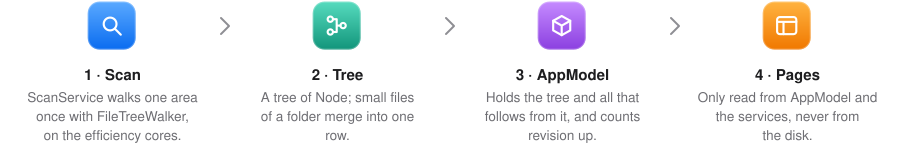
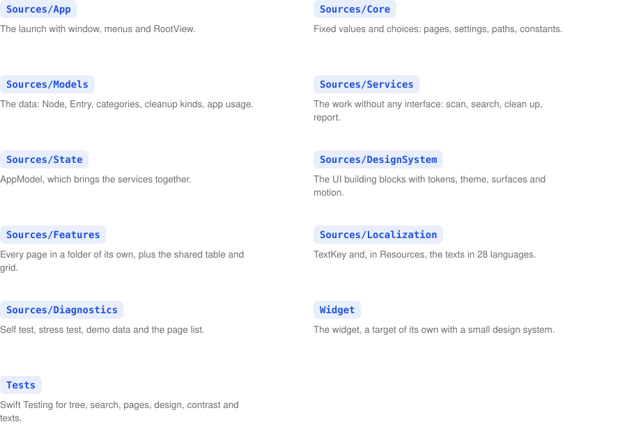
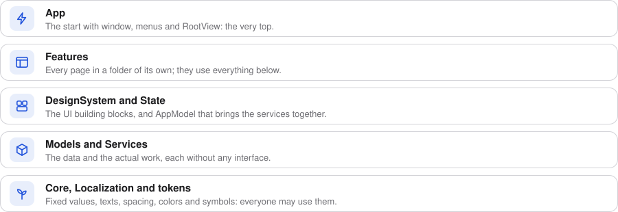

  

This description helps you work out where a change belongs. It names files and types, so you can find them with your
editor’s search. How to build and check is in the [contributing guide](CONTRIBUTING.md).

## What it is about

Storage Manager measures once how much space the Mac’s folders take up, and shows the result on several pages: as
an overview, as a folder tree, as a list of large files, while cleaning up and in hidden areas such as the temporary
folder of macOS. After the scan, every page gets by without any further disk access, except the duplicates: only
files of equal size can be the same, and `DuplicateService` reads just those, in the background.

## How the data flows

<picture>
  <source media="(prefers-color-scheme: dark)" srcset="assets/pictures/architecture-flow-dark.svg">
  
</picture>

<b>Each step in detail</b>

 

1. `ScanService` walks over one area of the disk once with `FileTreeWalker`, on the processor’s efficiency cores.
2. This produces a tree of `Node`. Each folder merges its subfolders and files under one megabyte into a single row.
   That keeps the tree small.
3. `AppModel` holds this tree and everything that follows from it: categories, cleanup suggestions, app copies and
   apps. It increments `revision` as soon as the tree changes.
4. The pages only read from `AppModel` and calculate with the services. They never touch the disk themselves.

## Code map

<picture>
  <source media="(prefers-color-scheme: dark)" srcset="assets/pictures/architecture-map-dark.svg">
  
</picture>

<b>Every folder in detail</b>

 

**`Sources/App`:** The app’s launch with window, menus and `RootView`. `RootView` holds the sidebar, the search and
the currently chosen page together.

**`Sources/Core`:** Fixed values and choices without any interface. `Pane` describes every page in the `details`
table. `Settings` contains the saved settings and the language choice, `Paths` the locations on disk and `Constants`
the adjustable numbers of the scan.

**`Sources/Models`:** The data: `Node` as the folder tree, `Entry` for a row in tables, plus categories, cleanup kinds
and app usage.

**`Sources/Services`:** The actual work, each without any interface. This includes scanning, categories, search,
cleaning up, the steps to free space, app copies, the summary for the report, thumbnails and everything that talks to
Finder or System Settings.

**`Sources/State`:** `AppModel`, which brings the services together and holds the state of the interface.

**`Sources/DesignSystem`:** All building blocks in the `UI` namespace with their variants. `Tokens` contains spacing,
icon sizes, text roles, measurements and symbol names, `Theme` the colors, `Surface` cards and button styles, and
`Motion` all animations.

**`Sources/Features`:** Every page in a folder of its own. `Pages.swift` maps each page to its view. `Shared`
contains the shared table and the shared grid for folders, search results and large files, and the layout switch in the
toolbar, whose choice the View menu shares.

**`Sources/Localization` and `Resources`:** `TextKey` contains all English text keys, and the 28 language folders
contain the texts.

**`Sources/Diagnostics`:** The self test with real folders, the stress test that operates the running app, the
made-up data of the demo mode and the page list that scripts ask for with `--list-pages`.

**`Widget`:** The widget, a target of its own. `scripts/build.py` puts it into the app as
`PlugIns/StorageWidget.appex`, with the app's identifier plus `.widget`, and signs it with the sandbox macOS requires
for widgets. Because of that sandbox it cannot read the app's data, so it measures the startup volume itself.
`WidgetStyle` is its small design system, `WidgetText` reads its texts from `Widget.strings`, and
`--render-widget <file> [light|dark]` draws it into a picture for checking its look.

**`Tests/StorageManagerTests`:** The tests, written with Swift Testing, for the folder tree, search, pages, design
values, contrast and translations. They build their folder trees by hand and never touch the disk.

<picture>
  <source media="(prefers-color-scheme: dark)" srcset="assets/pictures/architecture-layers-dark.svg">
  
</picture>

Which part may use which other one is a table in `scripts/checks/architecture.py`, and the check pipeline watches
it. Everyone may use the foundation of `Core`, `Localization` and the tokens with colors, spacing and symbols.
Models and services sit above it, then the design system and the state, then the pages and, at the very top, the
start of the app. The design system knows nothing of the app's state: its placeholders get the scan's status as a
`ScanStatus` from the environment, which `RootView` hands in.

## Deliberate rules

You cannot tell these rules from the code. Please only break one if you know the reason, and update it here.

**Privacy:** No part of the program prints file or folder names. The app sends nothing to the network.

**Deleting:** Deleting only happens after a confirmation. Copies of an app are only deleted when it is not running,
and that is checked once more right before deleting. Cleaning up works the same way: right before deleting, the list
of what may go is made again, so a cache whose app has started since, or a folder with a fresh file inside, stays. A
folder counts as old only when nothing inside it changed within the chosen days.

**One scan, not a second:** Everything the pages show comes from the tree of the last scan. A second pass over the
disk, for example for cleaning up, used to cost noticeable energy. The cleanup suggestions and the app list take their
sizes from the tree; only the short lists of candidate folders and installed apps are read again, in the background.
Only a folder’s information window analyzes it again in more detail on request.

**Charts without animation:** Swift Charts crashed when a chart animated between changing data during a scan. That is
why charts redraw without animation (`staticChart`) and wait until the scan has finished.

**Tables are rebuilt, not diffed:** When the whole content of a table changes, for example for a different folder or
a new search, `contentKey` rebuilds the table. Diffing thousands of new rows caused errors in AppKit, because the
table tried to update itself at the same time. For the same reason there are no resizable columns, and tables never
change inside an animation.

**Launch without animation:** The scan at launch starts before the window is drawn for the first time. If this
moment were animated, all cards would grow out of the top left corner. That is why the start and end of a scan are
not animated.

**Sidebar:** The app replaces the system’s button and menu command with its own, because when the sidebar was shown
through AppKit, the page jumped to its new width without any frames in between. SwiftUI animates it smoothly instead.
The button draws its glass circle itself, so that macOS does not leave an empty circle behind when it moves. On every
resize of the window, `SidebarState` compares whether the sidebar should be open, because at the threshold macOS
sometimes closes it by itself. For this `AppModel` reads the width directly from the window, because the width from SwiftUI
briefly jumps past the threshold during the motion.

**Advanced pages:** The temporary area and the app copies are for experts, so the sidebar lists them only when the
settings switch them on. They stay pages like any other: a launch argument or a link opens them either way.

**Floating sidebar:** In narrow windows the sidebar floats above the page. It is only slid in and out, never
removed, because otherwise the list inside it disappears abruptly. It is not hidden either, so that the glass effect
is kept.

**Loading:** Values that are still being calculated keep their place and show a small loading indicator
(`calculating`). Buttons that refer to these values wait until they are settled. Where there is more room,
`UI.Placeholder` shows what is currently loading.

**Main thread by default:** The code is written in Swift 6 with approachable concurrency, and everything runs on the
main thread unless it says otherwise; an async function without an actor runs where its caller runs. Only what really
works in the background, that is scanning, cleaning up, the analysis in the information window and the app copies, is
marked `nonisolated`, an async function that must leave the main thread is marked `@concurrent`, and work that needs a
lower priority starts in a `Task.detached`. The compiler then checks that no data is changed from two places at the
same time. A scan builds the folder tree in the background and then hands it over as a whole, which is why `Node` may
cross over.

**Self test and stress test only with Full Disk Access:** Both measure real folders. Without Full Disk Access, macOS
would ask separately for every protected folder and for the data of every other app, often hundreds of times. That is
why both check for Full Disk Access first and stop right away without it, and `make selftest` launches the built app
instead of the bare binary, so that macOS credits it with the app’s Full Disk Access.

**Demo mode:** With `-demo YES` the app fills itself with the made-up data from `DemoData` instead of scanning.
`AppModel` then blocks every disk access and every removal, and the information window does not analyze anything
either. The paths of the made-up files and cleanup entries do not exist, and a test checks that.

**Energy:** No animation runs while idle. The scan runs at low priority, and progress is reported at most twice per
second.

**Language and appearance:** Language, appearance and units come from System Settings. The app has no switches of
its own for them.

**Contrast:** Every text color reaches at least 4.5 to 1 in both appearances. That is why text for secondary
information uses the `muted` tone instead of the system color, which falls below that in light mode.

  

  <b>Storage Manager · See at a glance where your storage goes.</b> 
  <a href="README.md">Overview</a> · <a href="CONTRIBUTING.md">Contributing</a> · <a href="ARCHITECTURE.md">Architecture</a> · <a href="CODE_STYLE.md">Code rules</a> · <a href="CODE_OF_CONDUCT.md">Code of conduct</a> · <a href="CLAUDE.md">Working with Claude</a> 
  © 2026 Robertwlt03 · Released under the <a href="LICENSE">MIT license</a> · For macOS 27 on Macs with Apple silicon

