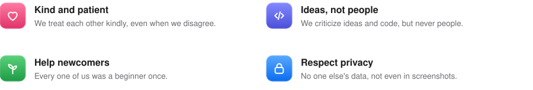

  

Storage Manager should be a place where everyone enjoys taking part, no matter how much experience they have, where
they come from or which language they speak.

## What we expect

<picture>
  <source media="(prefers-color-scheme: dark)" srcset="assets/pictures/conduct-expect-dark.svg">
  
</picture>

That includes screenshots: please never publish one that shows someone's private file or folder names.

## What is not okay

Insults, harassment, threats, discrimination and demeaning remarks have no place here, whether in issues, in pull
requests or anywhere else in the project.

## If something happens

If you experience or witness something that breaks these rules, please report it to the project’s maintainer through
GitHub. Every report is treated confidentially. Anyone who breaks the rules can be warned or excluded from the
project.

## Basis

These rules are based on the
[Contributor Covenant, version 2.1](https://www.contributor-covenant.org/version/2/1/code_of_conduct/), which many
open-source projects use. There you will find the full version in English.

  

  <b>Storage Manager · See at a glance where your storage goes.</b> 
  <a href="README.md">Overview</a> · <a href="CONTRIBUTING.md">Contributing</a> · <a href="ARCHITECTURE.md">Architecture</a> · <a href="CODE_STYLE.md">Code rules</a> · <a href="docs/pictures/README.md">Pictures</a> · <a href="CODE_OF_CONDUCT.md">Code of conduct</a> · <a href="CLAUDE.md">Working with Claude</a> 
  © 2026 Robertwlt03 · Released under the <a href="LICENSE">MIT license</a> · For macOS 27 on Macs with Apple silicon

