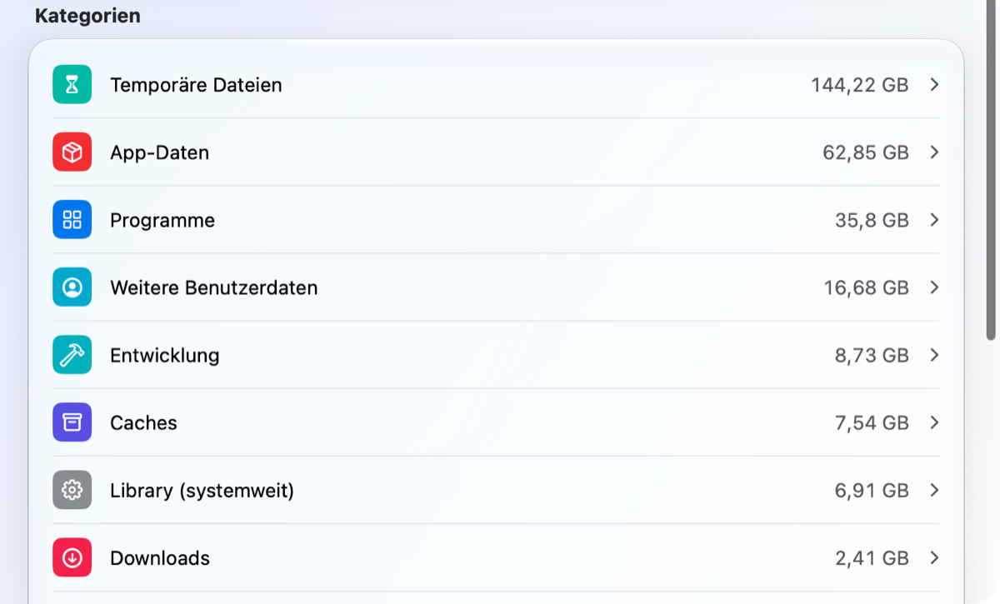
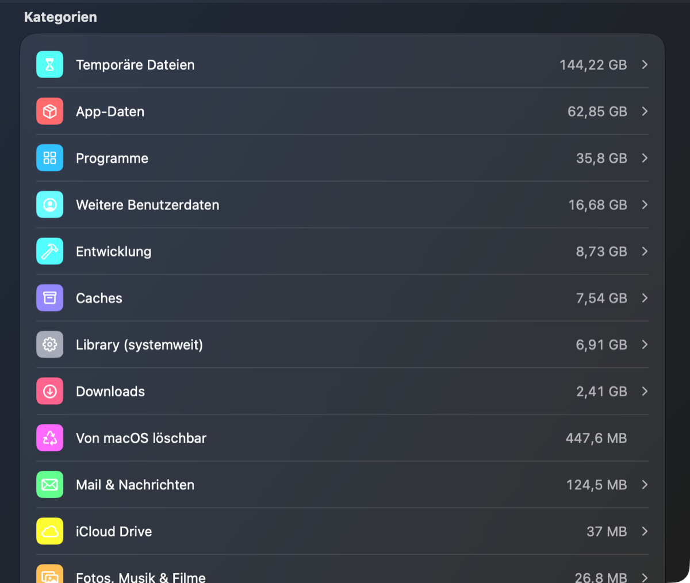
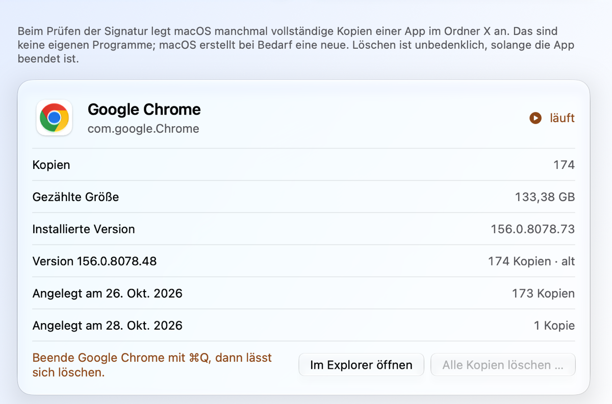
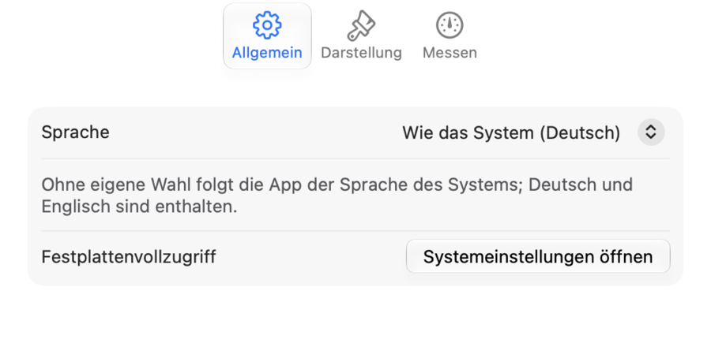

<p align="center">
  
</p>

<p align="center">
  
  
  
  
</p>

Der **Speicher-Explorer** zeigt dir, wo auf deinem Mac der Speicherplatz steckt. Er misst alle wichtigen Bereiche,
sortiert sie wie die Systemeinstellungen in verständliche Kategorien und findet auch das, was macOS sonst versteckt.
Alles bleibt auf deinem Mac: Die App liest nur Größen und schickt nichts ins Internet.

## Wofür ist die App?

Wenn macOS meldet, dass der Speicher fast voll ist, verrät „Speicher verwalten“ oft nur einen großen Block namens
„Systemdaten“. Der Speicher-Explorer schaut genauer hin. Er zeigt, welche Ordner wirklich groß sind, findet einzelne
riesige Dateien und deckt versteckte Ecken auf. Eine davon sind die **Prüfkopien**: Beim Prüfen von Apps legt macOS
manchmal vollständige Kopien an, im Fall von Chrome schon einmal über hundert Stück. Die App zeigt sie an und löscht
sie auf Wunsch, aber nur nach Rückfrage und nur, wenn die App dazu beendet ist.

## So sieht der Speicher-Explorer aus

<table>
  <tr>
    <td width="50%" valign="top"></td>
    <td width="50%" valign="top"></td>
  </tr>
  <tr>
    <td align="center"><sub><b>Überblick</b> – der Speicher nach Kategorien, hell …</sub></td>
    <td align="center"><sub>… oder dunkel, ganz wie dein Mac</sub></td>
  </tr>
  <tr>
    <td valign="top"></td>
    <td valign="top"></td>
  </tr>
  <tr>
    <td align="center"><sub><b>Prüfkopien</b> – Anzahl, Versionen und Löschen per Klick</sub></td>
    <td align="center"><sub><b>Einstellungen</b> – Sprache, Aussehen und Messen</sub></td>
  </tr>
</table>

## Was die App kann

- **Überblick** – dein Startvolume mit einem farbigen Balken und allen Kategorien, von Programmen über Downloads bis zu Caches.
- **Ordner** – klick dich wie im Finder durch alle Ordner, sortiert nach Größe.
- **Große Dateien** – alle Dateien ab einer Größe, die du selbst wählst.
- **Suche** – finde Ordner und Dateien nach ihrem Namen.
- **Versteckte Bereiche** – der temporäre Bereich von macOS und die Prüfkopien von Apps.
- **Datenträger** – auch externe Festplatten und USB-Sticks.
- **Einstellungen** – Deutsch oder Englisch, hell oder dunkel, Liquid Glass an oder aus und eigene Diagrammfarben.

## Installieren

Du brauchst einen Mac mit macOS 14 oder neuer und die Datei **Speicher-Explorer-1.0.dmg**. Alles Weitere geht mit der Maus.

**1. Öffne die DMG-Datei und ziehe den Speicher-Explorer in den Ordner „Programme“.**

<p align="center"></p>

**2. Öffne die App.** Beim ersten Mal meldet macOS, dass die App nicht überprüft werden konnte. Das liegt daran, dass
sie nicht über Apples kostenpflichtiges Entwicklerprogramm verteilt wird. Klicke auf „Fertig“.

<p align="center"></p>

**3. Erlaube den ersten Start.** Öffne Systemeinstellungen › Datenschutz & Sicherheit, scrolle ganz nach unten und
klicke auf „Trotzdem öffnen“. Das ist nur ein einziges Mal nötig, auch bei späteren Updates nicht mehr.

<p align="center"></p>

**4. Erteile den Festplattenvollzugriff.** Die App fragt danach und öffnet auf Wunsch die richtige Stelle in den
Systemeinstellungen. Schalte dort den Speicher-Explorer ein. Fehlt er in der Liste, fügst du ihn mit „+“ hinzu.

<p align="center"></p>

**5. Klicke in der App auf „App neu starten“.** Fertig: Ab jetzt misst sie alles ohne weitere Fragen.

<p align="center"></p>

<sub>Die Bilder zu den Schritten 1 bis 4 sind nachgezeichnete Skizzen; je nach macOS-Version sieht das Original leicht anders aus.</sub>

## Installieren mit der Konsole

Wer lieber das Terminal benutzt, kopiert diese Befehle einzeln hinein. Sie öffnen die DMG aus dem Download-Ordner,
kopieren die App nach „Programme“ und erlauben den ersten Start.

```bash
hdiutil attach ~/Downloads/Speicher-Explorer-1.0.dmg
```

```bash
cp -R "/Volumes/Speicher-Explorer/Speicher-Explorer.app" /Applications/
```

```bash
hdiutil detach "/Volumes/Speicher-Explorer"
```

```bash
xattr -dr com.apple.quarantine /Applications/Speicher-Explorer.app
```

```bash
open /Applications/Speicher-Explorer.app
```

Den Festplattenvollzugriff kann auch die Konsole nicht erteilen. Dieser Befehl öffnet dafür die passende Stelle in den
Systemeinstellungen:

```bash
open "x-apple.systempreferences:com.apple.preference.security?Privacy_AllFiles"
```

## Warum der Festplattenvollzugriff?

Ohne ihn fragt macOS für jeden geschützten Ort einzeln nach: Schreibtisch, Dokumente, Downloads, iCloud Drive, die
Daten anderer Apps und externe Datenträger. Der Festplattenvollzugriff ersetzt all diese Fragen durch einen einzigen
Schalter. Du kannst auch ohne ihn fortfahren und die einzelnen Fragen beantworten; dann fehlen nur die Bereiche, die
du ablehnst.

## Deine Daten bleiben bei dir

Die App liest nur Namen und Größen, nicht den Inhalt deiner Dateien, und schickt nichts ins Internet. Gelöscht wird nur
an einer einzigen Stelle, bei den Prüfkopien, und auch dort erst, nachdem du es ausdrücklich bestätigt hast.

## Sparsam mit Energie

Der Speicher-Explorer misst einmal alles in einem Durchgang, auf den stromsparenden Kernen deines Macs, und merkt sich
das Ergebnis. Klicken, Sortieren und Suchen kosten danach keine neue Messung, und wenn die App nur offen ist, braucht
sie praktisch keine Rechenleistung. Im Stromsparmodus misst sie nicht von selbst.

## Wie die App gebaut wurde

Der Speicher-Explorer ist eine echte Mac-App, geschrieben in Swift mit SwiftUI, Apples eigenem Werkzeug für
Mac-Oberflächen. Deshalb sieht sie aus wie die Apps von macOS selbst, passt sich an hell und dunkel an und nutzt ab
macOS 26 auf Wunsch Liquid Glass. Entstanden ist sie aus einem kleinen Terminal-Skript und wurde zusammen mit Claude
Schritt für Schritt zu einer vollständigen App ausgebaut.

<details>
<summary><b>Für Entwickler: selbst bauen</b></summary>

Voraussetzung sind die Command Line Tools von Apple (`xcode-select --install`); Xcode ist nicht nötig.

```bash
./build.sh
```

Für eine DMG zum Weitergeben gibt es ein eigenes Skript. Es signiert mit einem kostenlosen, eigenen Zertifikat
(einmalig anzulegen mit `scripts/create-signing-identity.sh`), damit der Festplattenvollzugriff bei allen Updates
erhalten bleibt. Mit einer Developer ID von Apple beglaubigt es die DMG zusätzlich, dann entfallen die Schritte 2 und 3.

```bash
scripts/release.sh
```

</details>

>  **Windows:** Eine Version für Windows ist geplant, aber noch nicht umgesetzt.

<p align="center">
  
</p>

<p align="center">
  <b>Speicher-Explorer · Sieh auf einen Blick, wo dein Speicher steckt.</b><br>
  <sub>© 2026 Robertwlt03 · Für macOS 14 oder neuer</sub>
</p>
