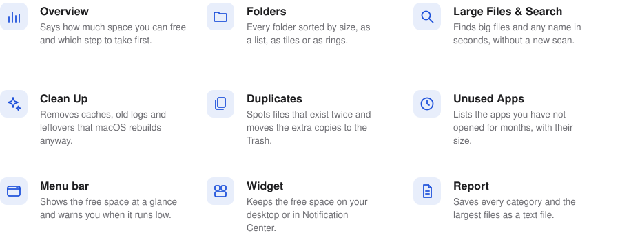
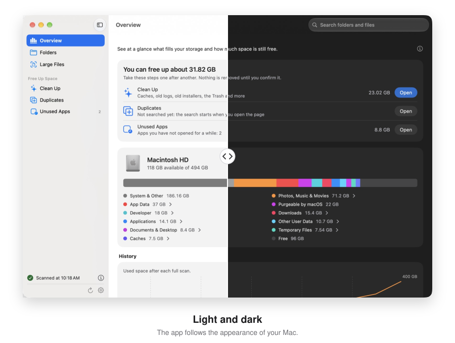

<p align="center">
  
</p>

<p align="center">
  <a href="https://github.com/Robertwlt03/storage-manager/releases/latest/download/Storage-Manager.dmg"><picture><source media="(prefers-color-scheme: dark)" srcset="assets/pictures/button-download-dark.svg"></picture></a>
  <a href="#install-it-in-a-minute"><picture><source media="(prefers-color-scheme: dark)" srcset="assets/pictures/button-install-dark.svg"></picture></a>
  <a href="https://github.com/Robertwlt03/storage-manager/releases"><picture><source media="(prefers-color-scheme: dark)" srcset="assets/pictures/button-versions-dark.svg"></picture></a>
</p>

**Storage Manager** shows you where the storage on your Mac goes. It measures all the important areas, sorts them
into categories that make sense, and also finds what macOS otherwise hides from you. Then it tells you how much you can
free and walks you there, one step at a time. Everything stays on your Mac, because the app only reads sizes and sends
nothing to the internet. It is free, runs on Macs with Apple silicon and macOS 27 or later, and speaks 28 languages.

<p align="center">
  <picture>
    <source media="(prefers-color-scheme: dark)" srcset="assets/pictures/tour-dark.svg">
    
  </picture>
</p>

## What it does

<picture>
  <source media="(prefers-color-scheme: dark)" srcset="assets/pictures/features-dark.svg">
  
</picture>

**Overview.** Right at the top it answers the real question: how much space you can free. It lists the steps to get
there, cleaning up, duplicates and unused apps, each with what it frees and a button to its page. Below, a colored bar
and its legend show what fills your Mac, and a click on a category opens it. After every full scan a line shows how
your storage changes over the weeks, with the folders that grew most.

**Folders, Large Files and Search.** You click through all folders like in Finder, sorted by size. Large Files shows
every file above a size you choose, and Search finds folders and files by name. A switch in the toolbar shows a list,
large tiles or, on Folders, rings around the current folder. A right-click moves a file to the Trash, after you
confirm it.

**Clean Up, Duplicates and Unused Apps.** Clean Up removes caches that apps rebuild on their own, old logs, old
temporary files and, if you want, old installers and the Trash; running apps and macOS stay untouched. Duplicates
finds large files that exist more than once and moves the extra copies to the Trash. Unused Apps lists the apps you
have not opened for a long time, with the date macOS itself keeps.

**Menu bar, widget and report.** The menu bar shows the free space even with the window closed and warns you when it
runs low, and the widget shows it on your desktop or in Notification Center. File › Export Report (⇧⌘E) saves every
category and the largest files as a text file.

**For advanced users**, “Show advanced areas” in the settings adds two areas you cannot see in Finder: the temporary
area of macOS and the app copies it creates when it checks apps. External drives appear in the sidebar as soon as you
connect them. Every page says in one sentence what it is for, and its info button explains more.

<p align="center">
  <picture>
    <source media="(prefers-color-scheme: dark)" srcset="assets/pictures/light-and-dark-dark.svg">
    
  </picture>
</p>

The app takes the light or dark appearance from your Mac, and with “Reduce motion” turned on in the Accessibility
settings, it leaves out its animations.

## Install it in a minute

You need a Mac with Apple silicon, meaning M1 or newer, running macOS 27 or later. Download
**[Storage-Manager.dmg](https://github.com/Robertwlt03/storage-manager/releases/latest/download/Storage-Manager.dmg)**,
then everything else you do with the mouse.

<p align="center">
  <picture>
    <source media="(prefers-color-scheme: dark)" srcset="assets/pictures/install-dark.svg">
    
  </picture>
</p>

1. **Open the DMG file and drag Storage Manager into the “Applications” folder.**
2. **Open the app.** The first time, macOS reports that it could not verify the app, because I do not distribute it
   through Apple’s paid developer program. Just click “Done” here.
3. **Allow the first launch.** In System Settings › Privacy & Security you find a notice about Storage Manager right
   at the bottom, with the button “Open Anyway”. You only do this once, and never again for later updates.
4. **Grant Full Disk Access.** The app asks for it at launch: click “Open System Settings” and turn Storage Manager
   on there. If it is missing from the list, add it with the plus button.
5. **In the app, click “Restart App”.** From now on it measures everything without asking you again.

**Why Full Disk Access?** Without it, macOS asks separately for every protected place: the Desktop, Documents,
Downloads, iCloud Drive, the data of other apps and external drives. Full Disk Access replaces all of these questions
with one switch. You can also go on without it and answer them one by one; the scan then only misses what you decline.

**Prefer the terminal?** These commands do the same: they open the DMG from your Downloads folder, copy the app to
“Applications”, allow the first launch and open it.

<picture>
  <source media="(prefers-color-scheme: dark)" srcset="assets/pictures/terminal-install-dark.svg">
  
</picture>

```bash
hdiutil attach ~/Downloads/Storage-Manager.dmg
cp -R "/Volumes/Storage Manager/Storage Manager.app" /Applications/
hdiutil detach "/Volumes/Storage Manager"
xattr -dr com.apple.quarantine "/Applications/Storage Manager.app"
open "/Applications/Storage Manager.app"
```

<sub>Most pictures are redrawn sketches of the English interface; depending on your macOS version, the original looks a
little different. The screenshots show the demo with made-up data.</sub>

## Made to be trusted

<picture>
  <source media="(prefers-color-scheme: dark)" srcset="assets/pictures/promises-dark.svg">
  
</picture>

The app only reads names and sizes, never the contents of your files, and it sends nothing to the internet. Something
is only deleted when you confirm it in Clean Up or for the app copies; apps and files you no longer need go to the
Trash, also only after you confirm it, and can be restored from there. Storage Manager measures everything once, on
the energy-efficient cores of your Mac, and then remembers the result, so clicking, sorting and searching never start
a new scan.

## Speaks your language

<picture>
  <source media="(prefers-color-scheme: dark)" srcset="assets/pictures/languages-dark.svg">
  
</picture>

The app follows the language of your Mac. To use a different one, pick it in the app's settings; it shows after a
restart.

## Why this app exists

I always wanted to know exactly how the storage on my Mac is split up. macOS only shows this very roughly, though, and
a large part often just ends up in a block called “System Data” without you ever learning what is inside. A small
script was my first step: with it I found out, for example, that macOS had created over a hundred copies of Google
Chrome that together took up more than a hundred gigabytes. But a script is not something you can simply hand on to
others, so I turned it into a proper Mac app that anyone can use without a terminal. It is written in Swift with
SwiftUI, Apple’s own toolkit, which is why it looks like the apps that come with macOS, and it grew step by step
together with Claude.

## Join in

Storage Manager is open source, and improvements are welcome. Report bugs and wishes in the [issues](../../issues);
the [contributing guide](CONTRIBUTING.md) shows how to build the app and send a pull request. Most translations were
made by machine, so improvements from native speakers are especially welcome.

<details>
<summary><b>All guides for contributors</b></summary>
<br>

- [Contributing](CONTRIBUTING.md): what you need, the short commands, checks, branches and pull requests.
- [Architecture](ARCHITECTURE.md): how the data flows, where things live in the code and the deliberate rules.
- [Code rules](CODE_STYLE.md): how we write code and how the checks enforce it.
- [Pictures for the guides](docs/pictures/README.md): how the grids, terminals and slideshows are drawn.
- [Code of conduct](CODE_OF_CONDUCT.md): how we treat each other.
- [Working with Claude](CLAUDE.md): the project's notes for Claude Code.

</details>

>  A version for **Windows** is planned, but not built yet.

<p align="center">
  
</p>

<p align="center">
  <b>Storage Manager · See at a glance where your storage goes.</b><br>
  <sub><a href="README.md">Overview</a> · <a href="CONTRIBUTING.md">Contributing</a> · <a href="ARCHITECTURE.md">Architecture</a> · <a href="CODE_STYLE.md">Code rules</a> · <a href="docs/pictures/README.md">Pictures</a> · <a href="CODE_OF_CONDUCT.md">Code of conduct</a> · <a href="CLAUDE.md">Working with Claude</a></sub><br>
  <sub>© 2026 Robertwlt03 · Released under the <a href="LICENSE">MIT license</a> · For macOS 27 on Macs with Apple silicon</sub>
</p>
