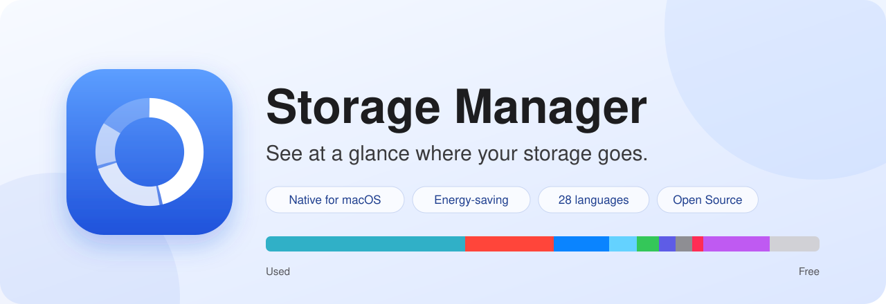
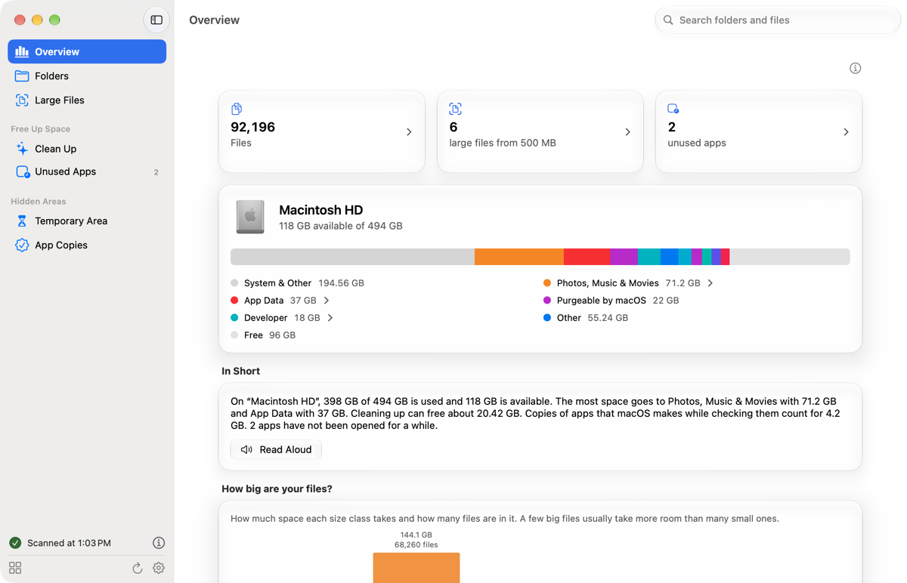
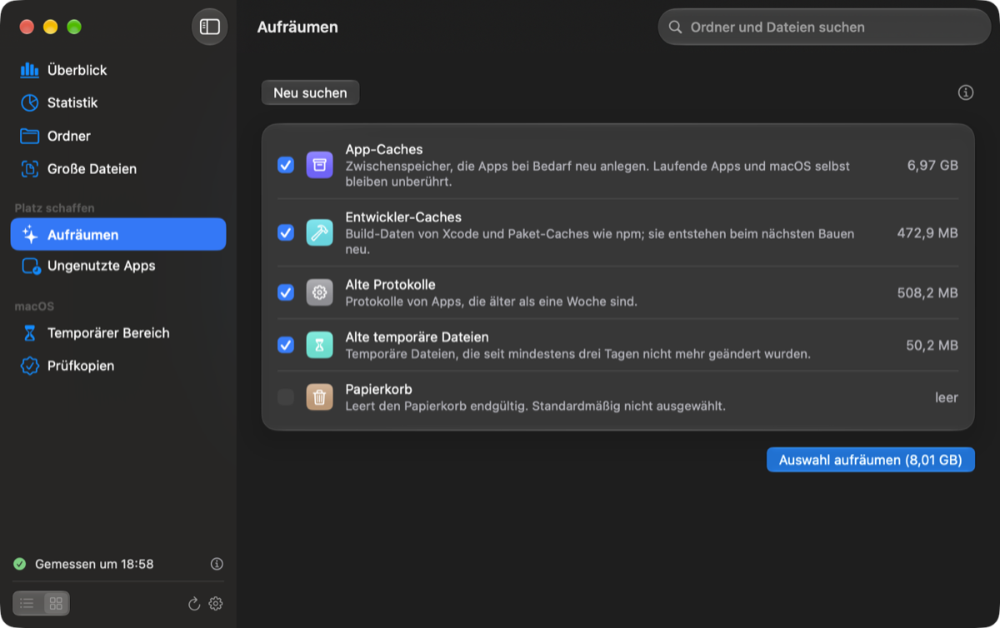
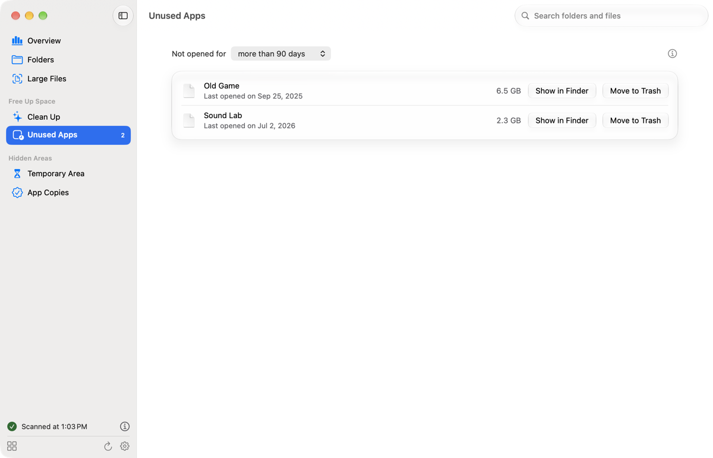
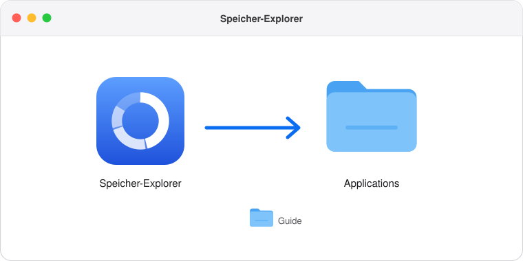
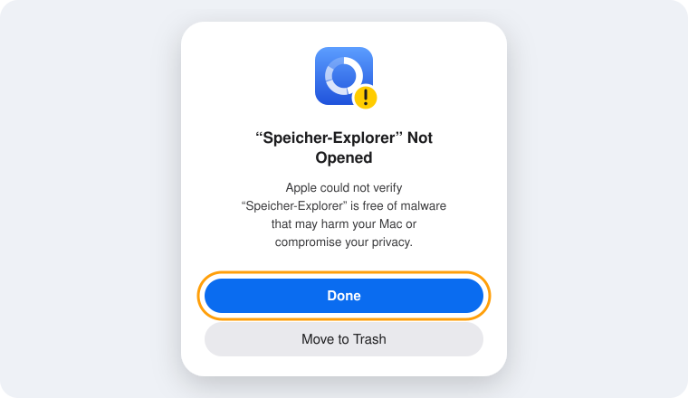
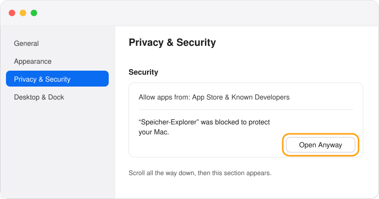
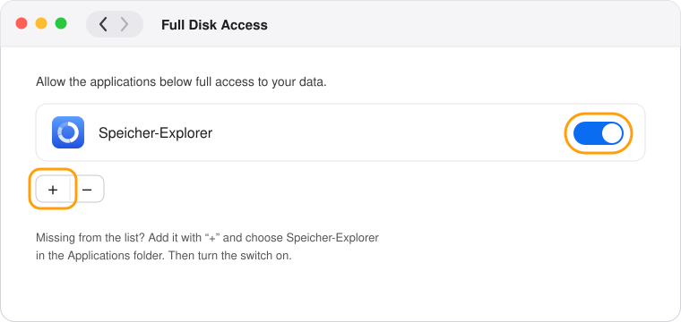
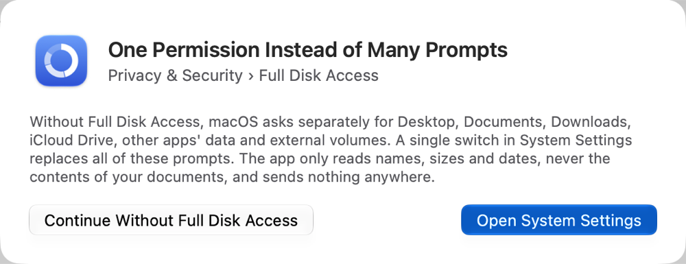

<p align="center">
  
</p>

<p align="center">
  
  
  
  
  <a href="LICENSE"></a>
</p>

**Speicher-Explorer** shows you where the storage on your Mac goes. It measures all the important areas, sorts them
into categories that make sense, and also finds what macOS otherwise hides from you. Everything stays on your Mac,
because the app only reads sizes and sends nothing to the internet.

## Why this app exists

I always wanted to know exactly how the storage on my Mac is split up. macOS only shows this very roughly, though,
and a large part often just ends up in a block called “System Data” without you ever learning what is inside. Until
now, if you wanted to know more, you either had to work in the terminal or write yourself a script that makes it
easier to move through the folders.

A script like that was my first step, too. With it I found out, for example, that macOS had created over a hundred
copies of Google Chrome that together took up more than a hundred gigabytes. But a script is not something you can
simply hand on to others. So I turned it into a proper app that is much friendlier to use, that anyone can work with
without a terminal, and that you can share with others without having to wait for an update from Apple.

## What Speicher-Explorer looks like

<table>
  <tr>
    <td width="50%" valign="top"></td>
    <td width="50%" valign="top"></td>
  </tr>
  <tr>
    <td align="center"><sub>The <b>Overview</b> with storage bar, legend and a short summary</sub></td>
    <td align="center"><sub>In <b>Clean Up</b> you choose what may go, shown here in dark appearance</sub></td>
  </tr>
  <tr>
    <td colspan="2" align="center" valign="top"></td>
  </tr>
  <tr>
    <td colspan="2" align="center"><sub><b>Unused Apps</b> lists the apps you have not opened for a long time</sub></td>
  </tr>
</table>

<sub>The pictures show the demo with made-up data, which `make demo` opens.</sub>

## What the app can do

The **Overview** is your home page. Right at the top are the most important numbers, such as how many files you
have, how many of them are large and how many apps you have not opened for a long time, and clicking one takes you
straight to the matching page. Below that, it shows your Mac with a colored bar and a legend. It then sums up in a
few sentences how your storage is doing, and reads that out to you if you like. A chart also shows you how much space
small and large files take up, and at the very bottom you find all categories, from applications and downloads to
caches.

In **Folders** you click your way through all folders just like in Finder, sorted by size. **Large Files** shows you
all files above a size you choose yourself, and **Search** finds folders and files by name. You can also show each of
these lists as a grid of large tiles.

In **Clean Up** you remove files your system barely needs. These include caches that apps rebuild on their own, old
logs, old temporary files and, if you want, the Trash. Apps that are currently running, and macOS itself, are left
untouched.

The **Unused Apps** page reminds you of apps you have not opened for a long time. The date comes from macOS itself,
so the app records nothing. Anything you no longer need, you can move to the Trash from there.

The app also shows two areas you cannot see in Finder: the **temporary area** of macOS and the **app copies** that
macOS creates when it checks apps. External drives and USB sticks appear in the sidebar too, as soon as you connect
them.

Every page has an info button at the top right that explains what the page is for. The app speaks 20 languages,
including German, English, French, Spanish, Japanese and Chinese, and follows the language of your Mac. If you want
to use the app in a different language, set it in System Settings under General, Language & Region and then
Applications. It also takes the light or dark appearance from your Mac, and it uses Liquid Glass. New content appears
with gentle motion, and if you have turned on “Reduce motion” in the Accessibility settings, the app leaves it out.

## Installing

You need a Mac with Apple silicon, meaning M1 or newer, running macOS 27 or later, and the file **Speicher-Explorer-1.0.dmg**. Everything else you do
with the mouse.

**1. Open the DMG file and drag Speicher-Explorer into the “Applications” folder.**

<p align="center"></p>

**2. Open the app.** The first time, macOS reports that it could not verify the app. That is because I do not
distribute it through Apple’s paid developer program. Just click “Done” here.

<p align="center"></p>

**3. Allow the first launch.** Open System Settings and go to “Privacy & Security”. Right at the bottom you will find
a notice about Speicher-Explorer with the button “Open Anyway”. You only have to do this once, and never again for
later updates.

<p align="center"></p>

**4. Grant Full Disk Access.** The app asks for it at launch and, if you like, opens the right place in System
Settings. Turn Speicher-Explorer on there. If it is missing from the list, add it with the plus button.

<p align="center"></p>

**5. In the app, click “Restart App”.** From now on it measures everything without asking you again.

<p align="center"></p>

<sub>The pictures for steps 1 to 4 are redrawn sketches, and they show the English interface. Depending on your macOS version, the original looks a little different.</sub>

## Installing from the terminal

If you prefer working in the terminal, paste these commands in one after another. They open the DMG from your
Downloads folder, copy the app to “Applications” and allow the first launch.

```bash
hdiutil attach ~/Downloads/Speicher-Explorer-1.0.dmg
```

```bash
cp -R "/Volumes/Speicher-Explorer/Speicher-Explorer.app" /Applications/
```

```bash
hdiutil detach "/Volumes/Speicher-Explorer"
```

```bash
xattr -dr com.apple.quarantine /Applications/Speicher-Explorer.app
```

```bash
open /Applications/Speicher-Explorer.app
```

Not even the terminal can grant Full Disk Access; that only works with the switch. This command opens the right place
in System Settings for it:

```bash
open "x-apple.systempreferences:com.apple.preference.security?Privacy_AllFiles"
```

## Why Full Disk Access?

Without it, macOS asks separately for every protected location, that is for the Desktop, Documents, Downloads, iCloud
Drive, the data of other apps and external drives. Full Disk Access replaces all of these questions with a single
switch. You can also carry on without it and answer the individual questions. Then the scan only misses the areas you
decline.

## Your data stays with you

The app only reads names and sizes, never the contents of your files, and it sends nothing to the internet.
Something is only deleted when you explicitly confirm it in Clean Up or for the app copies. Apps you no longer need
go to the Trash and can be restored from there.

## Easy on energy

Speicher-Explorer measures everything once, in a single pass. To do that it uses the energy-efficient cores of your
Mac and then remembers the result. Clicking, sorting and searching therefore never trigger a new scan. When the app is
simply open, it needs practically no computing power, and in Low Power Mode it does not scan on its own.

## How the app was built

Speicher-Explorer is a real Mac app, written in Swift with SwiftUI, Apple’s own toolkit for Mac interfaces. That is
why it looks like the apps that come with macOS and adapts to light and dark. It grew out of my small terminal
script, which I expanded step by step into a complete app together with Claude.

<details>
<summary><b>For developers: build it yourself</b></summary>

You need Xcode 27 from the App Store, but only as a toolbox: building happens in the terminal, and you can use any
editor you like. After installing it, switch the tools over to Xcode once.

```bash
sudo xcode-select --switch /Applications/Xcode.app
```

```bash
make run
```

`make` shows you all the short commands, and the [contributing guide](CONTRIBUTING.md) explains them. There is a
separate script for a DMG to pass on. It signs the app with a free certificate of your own, which you create once
with `make identity`. That way Full Disk Access survives every update. With a Developer ID from Apple, the script
also notarizes the DMG, and then steps 2 and 3 of the installation are no longer needed.

```bash
make release
```

The code is split into small parts, and every file has exactly one job:

| Folder | Contents |
| --- | --- |
| `Sources/Features` | One folder for each page of the app, for example Overview, Folders and Clean Up. `Pages.swift` maps each page to its view. |
| `Sources/DesignSystem` | All interface building blocks in the `UI` namespace, with fixed variants, plus spacing, fonts and colors. |
| `Sources/Services` | Scanning, categories, cleaning up, apps, search, summary and reading aloud. |
| `Sources/State` | The app state that brings the services together. |
| `Sources/Core` | Constants and fixed choices such as pages and settings. |
| `Sources/Localization` and `Resources` | All texts in 20 languages, with German and English as the source. |
| `Sources/Diagnostics` | A self test with real data and a stress test for the running app. |
| `Tests` | The tests for the folder tree, categories, search, design, contrast and translations. |
| `scripts` | The code inspection, your own signing certificate and building the DMG. |

</details>

## Contributing

Speicher-Explorer is open source. Anyone can read the code, improve it and bring in their own ideas. You can report
bugs and wishes in the [issues](../../issues), and I am happy to take improvements as pull requests. How to get
started is in the [contributing guide](CONTRIBUTING.md), where to find what in the code is in the
[architecture description](ARCHITECTURE.md), and how we write code is in the [code rules](CODE_STYLE.md). For how we treat each other, the [code of conduct](CODE_OF_CONDUCT.md) applies.
Please add new texts in all languages, because otherwise the check during the build reports what is missing. Most
translations were made by machine, so I am especially glad about improvements from native speakers.

>  A version for **Windows** is planned, but not built yet.

<p align="center">
  
</p>

<p align="center">
  <b>Speicher-Explorer · See at a glance where your storage goes.</b><br>
  <sub><a href="README.md">Overview</a> · <a href="CONTRIBUTING.md">Contributing</a> · <a href="ARCHITECTURE.md">Architecture</a> · <a href="CODE_STYLE.md">Code rules</a> · <a href="CODE_OF_CONDUCT.md">Code of conduct</a> · <a href="CLAUDE.md">Working with Claude</a></sub><br>
  <sub>© 2026 Robertwlt03 · Released under the <a href="LICENSE">MIT license</a> · For macOS 27 on Macs with Apple silicon</sub>
</p>
