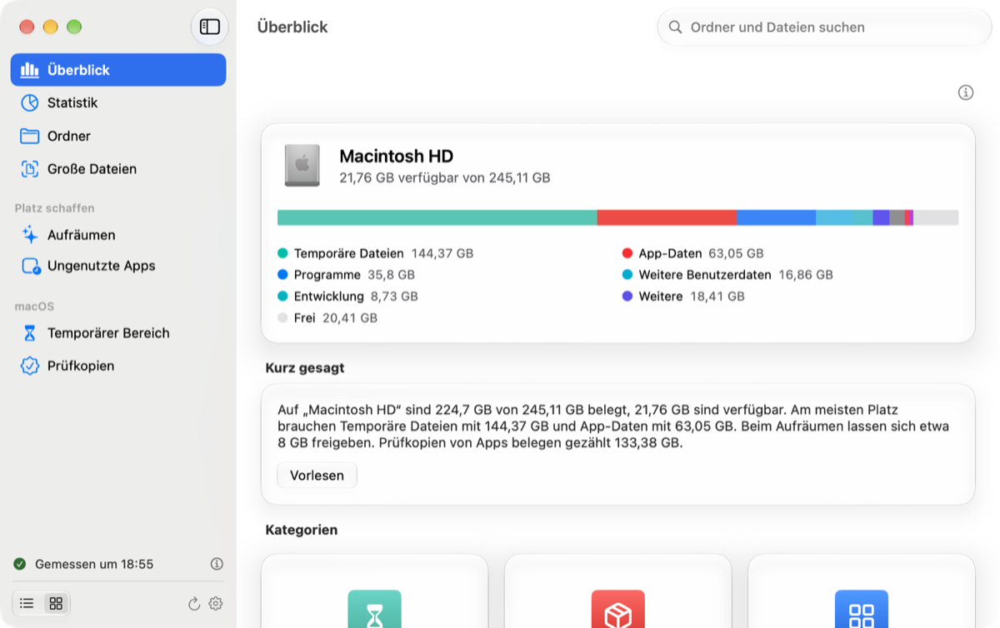
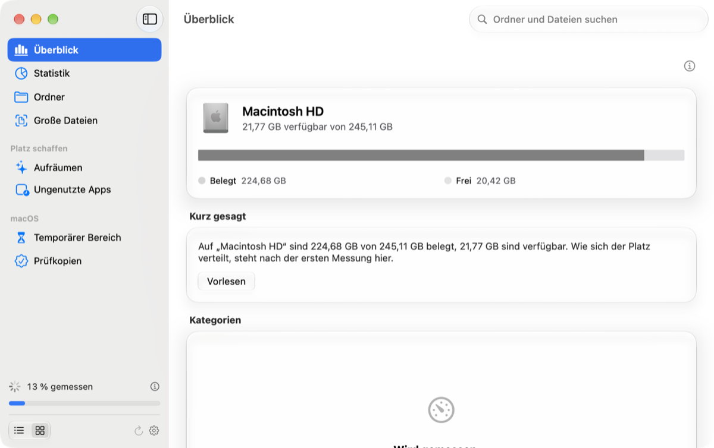
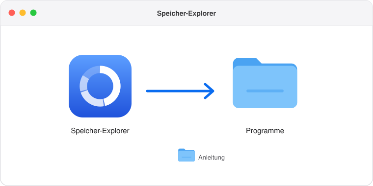
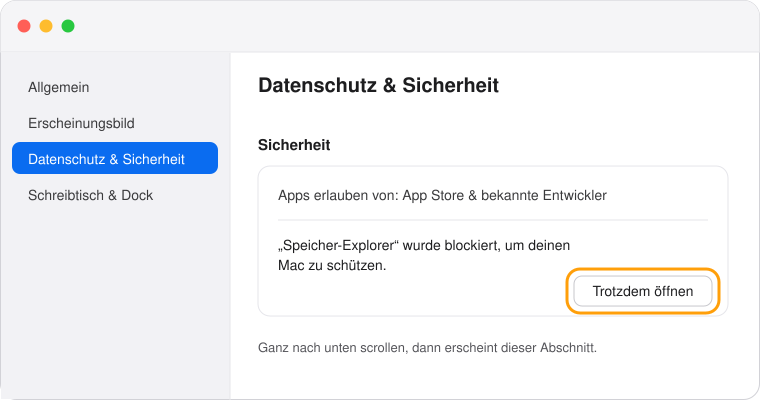
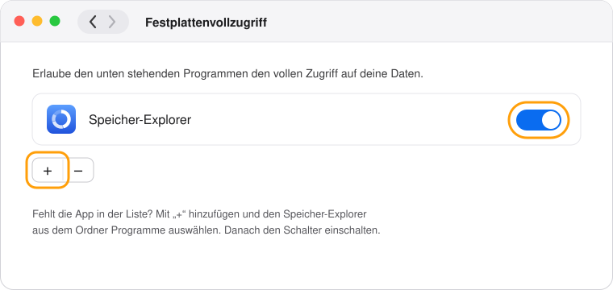
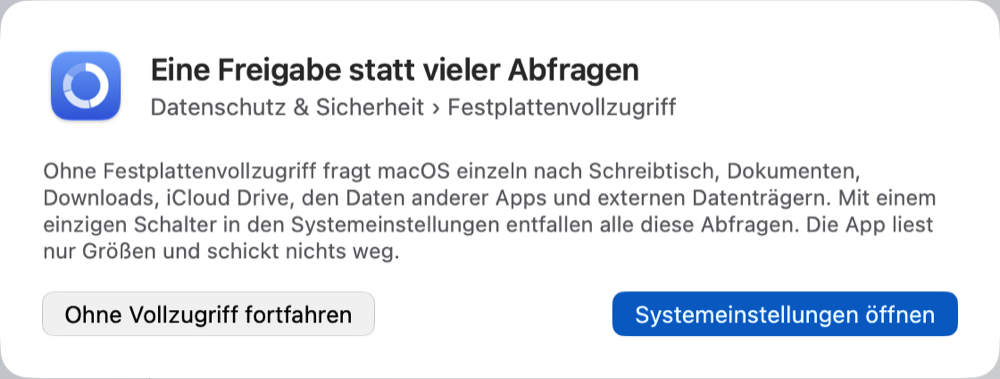

<p align="center">
  
</p>

<p align="center">
  
  
  
  
  <a href="LICENSE"></a>
</p>

Der **Speicher-Explorer** zeigt dir, wo auf deinem Mac der Speicherplatz steckt. Er misst alle wichtigen Bereiche,
sortiert sie in verständliche Kategorien und findet auch das, was macOS sonst vor dir versteckt. Alles bleibt dabei
auf deinem Mac, denn die App liest nur Größen und schickt nichts ins Internet.

## Warum es diese App gibt

Ich wollte immer genau wissen, wie sich der Speicher auf meinem Mac verteilt. macOS zeigt das aber nur sehr grob an,
und oft landet ein großer Teil einfach in einem Block namens „Systemdaten“, ohne dass man erfährt, was darin steckt.
Wer es genauer wissen wollte, musste bisher entweder mit der Konsole arbeiten oder sich selbst ein Skript schreiben,
mit dem man sich besser durch die Ordner bewegen kann.

Genau so ein Skript war auch mein erster Schritt. Damit habe ich zum Beispiel herausgefunden, dass macOS über hundert
Kopien von Google Chrome angelegt hatte, die zusammen mehr als hundert Gigabyte belegten. Ein Skript ist aber nichts,
was man einfach weitergeben kann. Deshalb habe ich daraus eine richtige App gemacht, die viel benutzerfreundlicher
ist, die jeder ohne Konsole bedienen kann und die man mit anderen teilen kann, ohne auf ein Update von Apple warten
zu müssen.

## So sieht der Speicher-Explorer aus

<table>
  <tr>
    <td width="50%" valign="top"></td>
    <td width="50%" valign="top"></td>
  </tr>
  <tr>
    <td align="center"><sub>Der <b>Überblick</b> mit Speicherbalken, Legende und einer kurzen Zusammenfassung</sub></td>
    <td align="center"><sub>Beim <b>Aufräumen</b> wählst du aus, was weg darf, hier im dunklen Erscheinungsbild</sub></td>
  </tr>
  <tr>
    <td colspan="2" align="center" valign="top"></td>
  </tr>
  <tr>
    <td colspan="2" align="center"><sub>Während der <b>Messung</b> zeigt die Seitenleiste unten den Fortschritt</sub></td>
  </tr>
</table>

## Was die App kann

Der **Überblick** ist deine Startseite. Ganz oben stehen die wichtigsten Zahlen, also wie viele Dateien du hast, wie
viele davon groß sind und wie viele Apps du lange nicht geöffnet hast, und ein Klick darauf führt dich direkt zur
passenden Seite. Darunter zeigt er deinen Mac mit einem farbigen Balken und einer Legende. Danach fasst er in wenigen
Sätzen zusammen, wie es um deinen Speicher steht, und liest dir das auf Wunsch auch vor. Ein Diagramm zeigt dir
außerdem, wie viel Platz kleine und große Dateien belegen, und ganz unten findest du alle Kategorien, von Programmen
über Downloads bis zu Caches.

Unter **Ordner** klickst du dich wie im Finder durch alle Ordner, nach Größe sortiert. Bei **Große Dateien** siehst du
alle Dateien ab einer Größe, die du selbst wählst, und mit der **Suche** findest du Ordner und Dateien nach ihrem
Namen. Jede dieser Listen kannst du auch als Raster mit großen Kacheln anzeigen.

Beim **Aufräumen** entfernst du Dateien, die dein System kaum braucht. Dazu gehören Zwischenspeicher, die Apps von
selbst neu anlegen, alte Protokolle, alte temporäre Dateien und auf Wunsch der Papierkorb. Apps, die gerade laufen,
und macOS selbst bleiben dabei unberührt.

Die Seite **Ungenutzte Apps** erinnert dich an Apps, die du lange nicht geöffnet hast. Das Datum stammt von macOS
selbst, die App zeichnet also nichts auf. Was du nicht mehr brauchst, legst du von dort in den Papierkorb.

Außerdem zeigt die App zwei Bereiche, die man im Finder nicht sieht: den **temporären Bereich** von macOS und die
**App-Kopien**, die macOS beim Prüfen von Apps anlegt. Auch externe Festplatten und USB-Sticks erscheinen in der
Seitenleiste, sobald du sie anschließt.

Jede Seite hat oben rechts einen Info-Knopf, der erklärt, wofür sie da ist. Die App spricht 20 Sprachen, darunter
Deutsch, Englisch, Französisch, Spanisch, Japanisch und Chinesisch, und richtet sich dabei nach der Sprache deines Macs.
Wenn du die App in einer anderen Sprache nutzen möchtest, stellst du das in den Systemeinstellungen unter Allgemein,
Sprache & Region und dann Apps ein. Auch das helle oder dunkle Erscheinungsbild übernimmt sie von deinem Mac, und ab
macOS 26 nutzt sie Liquid Glass. Neue Inhalte
erscheinen mit sanften Bewegungen, und wenn du in den Bedienungshilfen „Bewegung reduzieren“ eingeschaltet hast,
verzichtet die App darauf.

## Installieren

Du brauchst einen Mac mit macOS 14 oder neuer und die Datei **Speicher-Explorer-1.0.dmg**. Alles Weitere erledigst du
mit der Maus.

**1. Öffne die DMG-Datei und ziehe den Speicher-Explorer in den Ordner „Programme“.**

<p align="center"></p>

**2. Öffne die App.** Beim ersten Mal meldet macOS, dass es die App nicht überprüfen konnte. Das liegt daran, dass ich
sie nicht über Apples kostenpflichtiges Entwicklerprogramm verteile. Klicke hier einfach auf „Fertig“.

<p align="center"></p>

**3. Erlaube den ersten Start.** Öffne die Systemeinstellungen und dort den Bereich „Datenschutz & Sicherheit“. Ganz
unten findest du einen Hinweis zum Speicher-Explorer mit dem Knopf „Trotzdem öffnen“. Das musst du nur ein einziges
Mal machen, auch bei späteren Updates nicht mehr.

<p align="center"></p>

**4. Erteile den Festplattenvollzugriff.** Die App fragt beim Start danach und öffnet auf Wunsch die richtige Stelle in
den Systemeinstellungen. Schalte dort den Speicher-Explorer ein. Falls er in der Liste fehlt, fügst du ihn mit dem
Pluszeichen hinzu.

<p align="center"></p>

**5. Klicke in der App auf „App neu starten“.** Ab jetzt misst sie alles, ohne dich weiter zu fragen.

<p align="center"></p>

<sub>Die Bilder zu den Schritten 1 bis 4 sind nachgezeichnete Skizzen. Je nach macOS-Version sieht das Original etwas anders aus.</sub>

## Installieren mit der Konsole

Wenn du lieber mit dem Terminal arbeitest, kopierst du diese Befehle nacheinander hinein. Sie öffnen die DMG aus deinem
Download-Ordner, kopieren die App nach „Programme“ und erlauben den ersten Start.

```bash
hdiutil attach ~/Downloads/Speicher-Explorer-1.0.dmg
```

```bash
cp -R "/Volumes/Speicher-Explorer/Speicher-Explorer.app" /Applications/
```

```bash
hdiutil detach "/Volumes/Speicher-Explorer"
```

```bash
xattr -dr com.apple.quarantine /Applications/Speicher-Explorer.app
```

```bash
open /Applications/Speicher-Explorer.app
```

Den Festplattenvollzugriff kann auch die Konsole nicht erteilen, das geht nur über den Schalter. Dieser Befehl öffnet
dafür die passende Stelle in den Systemeinstellungen:

```bash
open "x-apple.systempreferences:com.apple.preference.security?Privacy_AllFiles"
```

## Warum der Festplattenvollzugriff?

Ohne ihn fragt macOS für jeden geschützten Ort einzeln nach, also für den Schreibtisch, die Dokumente, die Downloads,
iCloud Drive, die Daten anderer Apps und externe Datenträger. Der Festplattenvollzugriff ersetzt all diese Fragen durch
einen einzigen Schalter. Du kannst auch ohne ihn weitermachen und die einzelnen Fragen beantworten. Dann fehlen in der
Messung nur die Bereiche, die du ablehnst.

## Deine Daten bleiben bei dir

Die App liest nur Namen und Größen, aber nie den Inhalt deiner Dateien, und sie schickt nichts ins Internet. Etwas
gelöscht wird nur, wenn du es beim Aufräumen oder bei den App-Kopien ausdrücklich bestätigst. Apps, die du nicht mehr
brauchst, landen im Papierkorb und lassen sich von dort wiederherstellen.

## Sparsam mit Energie

Der Speicher-Explorer misst einmal alles in einem einzigen Durchgang. Dafür nutzt er die stromsparenden Kerne deines
Macs und merkt sich danach das Ergebnis. Klicken, Sortieren und Suchen kosten deshalb keine neue Messung. Wenn die App
nur offen ist, braucht sie praktisch keine Rechenleistung, und im Stromsparmodus misst sie nicht von selbst.

## Wie die App gebaut wurde

Der Speicher-Explorer ist eine echte Mac-App, geschrieben in Swift mit SwiftUI, also mit Apples eigenem Werkzeug für
Mac-Oberflächen. Deshalb sieht sie aus wie die Apps von macOS selbst und passt sich an hell und dunkel an. Entstanden
ist sie aus meinem kleinen Terminal-Skript, das ich zusammen mit Claude Schritt für Schritt zu einer vollständigen App
ausgebaut habe.

<details>
<summary><b>Für Entwickler: selbst bauen</b></summary>

Du brauchst die Command Line Tools von Apple, die du mit `xcode-select --install` installierst. Xcode selbst ist nicht
nötig.

```bash
./build.sh
```

Für eine DMG zum Weitergeben gibt es ein eigenes Skript. Es signiert die App mit einem kostenlosen, eigenen
Zertifikat, das du einmalig mit `scripts/create-signing-identity.sh` anlegst. Dadurch bleibt der Festplattenvollzugriff
bei allen Updates erhalten. Mit einer Developer ID von Apple beglaubigt das Skript die DMG zusätzlich, und dann
entfallen die Schritte 2 und 3 der Installation.

```bash
scripts/release.sh
```

Der Code ist in kleine Teile gegliedert, und jede Datei hat genau eine Aufgabe:

| Ordner | Inhalt |
| --- | --- |
| `Sources/Features` | Für jede Seite der App ein eigener Ordner, zum Beispiel Überblick, Ordner und Aufräumen. `Pages.swift` ordnet jeder Seite ihre Ansicht zu. |
| `Sources/DesignSystem` | Alle Bausteine der Oberfläche im Namensraum `UI`, mit festen Varianten, dazu Abstände, Schriften und Farben. |
| `Sources/Services` | Messen, Kategorien, Aufräumen, Apps, Suche, Zusammenfassung und Vorlesen. |
| `Sources/State` | Der Zustand der App, der die Services zusammenführt. |
| `Sources/Core` | Konstanten und feste Auswahlwerte wie Seiten und Einstellungen. |
| `Sources/Localization` und `Resources` | Alle Texte in 20 Sprachen, mit Deutsch und Englisch als Vorlage. |
| `Sources/Diagnostics` | Prüfungen für Kontrast und Texte und ein Selbsttest mit echten Daten. |
| `Tests` | Die Tests für Ordnerbaum, Suche, Gestaltung, Kontrast und Übersetzungen. |
| `scripts` | Die Code-Inspektion, das eigene Zertifikat zum Signieren und das Erstellen der DMG. |

</details>

## Mitmachen

Der Speicher-Explorer ist Open Source. Jeder kann den Code ansehen, verbessern und eigene Ideen einbringen. Fehler und
Wünsche kannst du in den [Issues](../../issues) melden, und Verbesserungen nehme ich gern als Pull Request entgegen.
Wie du anfängst, steht in der [Anleitung zum Mitmachen](CONTRIBUTING.md), wo du was im Code findest, in der
[Architektur-Beschreibung](ARCHITECTURE.md), und wie wir Code schreiben, in den [Code-Regeln](CODE_STYLE.md). Für den Umgang miteinander gelten die [Verhaltensregeln](CODE_OF_CONDUCT.md).
Neue Texte legst du bitte in allen Sprachen an, denn die Prüfung beim Bauen meldet sonst, was fehlt. Die meisten
Übersetzungen sind maschinell entstanden, deshalb freue ich mich besonders über Verbesserungen von Muttersprachlern.

>  Eine Version für **Windows** ist geplant, aber noch nicht umgesetzt.

<p align="center">
  
</p>

<p align="center">
  <b>Speicher-Explorer · Sieh auf einen Blick, wo dein Speicher steckt.</b><br>
  <sub><a href="README.md">Übersicht</a> · <a href="CONTRIBUTING.md">Mitmachen</a> · <a href="ARCHITECTURE.md">Architektur</a> · <a href="CODE_STYLE.md">Code-Regeln</a> · <a href="CODE_OF_CONDUCT.md">Verhaltensregeln</a></sub><br>
  <sub>© 2026 Robertwlt03 · Veröffentlicht unter der <a href="LICENSE">MIT-Lizenz</a> · Für macOS 14 oder neuer</sub>
</p>
