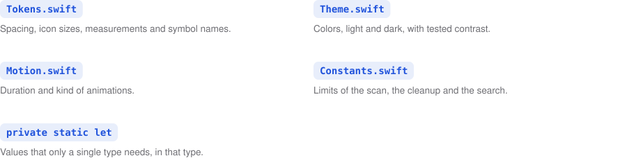
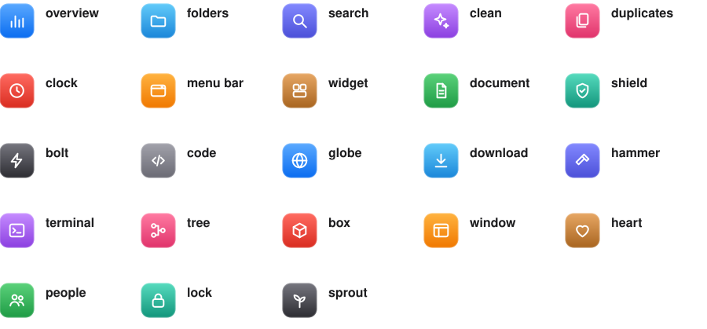
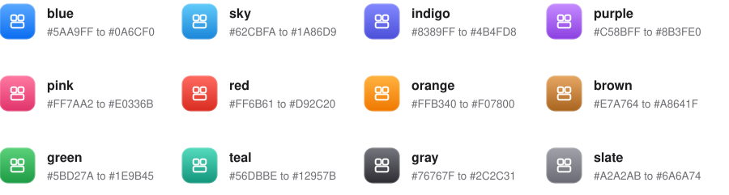

<p align="center">
  
</p>

The guides show lists, tables, steps and terminal sessions as pictures that look like the Mac: grids without frames,
terminal windows that type, flows, layers and slideshows. Every picture is a small JSON file in this folder, and
`make pictures` draws it twice, once light and once dark, into `assets/pictures`. GitHub then shows the one that fits
the reader's appearance. The script behind it is [`scripts/pictures.py`](../../scripts/pictures.py).

## Drawing them

`make pictures` draws every description in this folder. Name some to draw only those, and point `--shots` at another
folder of screenshots if the tour should not use the pictures of `make snapshots`:

```bash
make pictures
```

```bash
scripts/pictures.py features languages
```

```bash
scripts/pictures.py tour --shots ~/Desktop/shots
```

## Showing one in a guide

A guide shows both versions through `<picture>`, so the dark one appears in dark appearance. The alt text holds
every word of the picture, because a screen reader and the search cannot read inside it. Commands people copy stay
in a code block below the picture. The paths are relative to the guide, so this one, two folders down, starts them
with `../../`:

```html
<picture>
  <source media="(prefers-color-scheme: dark)" srcset="../../assets/pictures/features-dark.svg">
  
</picture>
```

## The kinds

Every description names its `kind`. Most kinds take a list of `items`, and every item may have its own glyph and
color. A `label` is optional: without one, the picture's text for screen readers is built from the items.

### Button

One large button with a glyph, a title and a small line, such as the download button of the README.

<p align="center">
  <picture>
    <source media="(prefers-color-scheme: dark)" srcset="../../assets/pictures/download-dark.svg">
    
  </picture>
</p>

```json
{"kind": "button", "title": "Download for Mac", "line": "Free · macOS 27 · Apple silicon",
 "glyph": "download", "color": "blue", "label": "Download Storage Manager for Mac"}
```

### Grid

Items in columns without frames, each a tile with a glyph, a title and a sentence. The rows grow with the longest
sentence, so nothing is cut off.

<picture>
  <source media="(prefers-color-scheme: dark)" srcset="../../assets/pictures/promises-dark.svg">
  
</picture>

```json
{"kind": "grid", "columns": 4, "items": [
  {"glyph": "shield", "color": "green", "title": "Private",
   "text": "Reads only names and sizes and sends nothing to the internet."}]}
```

With `"code": true` the title becomes a command or a path in a monospace chip, and the tile falls away:

<picture>
  <source media="(prefers-color-scheme: dark)" srcset="../../assets/pictures/code-style-homes-dark.svg">
  
</picture>

```json
{"kind": "grid", "code": true, "columns": 2, "items": [
  {"title": "Theme.swift", "text": "Colors, light and dark, with tested contrast."}]}
```

### Chips

A short code in a chip, a name and a smaller second name, such as the languages.

<picture>
  <source media="(prefers-color-scheme: dark)" srcset="../../assets/pictures/languages-dark.svg">
  
</picture>

```json
{"kind": "chips", "columns": 4, "items": [{"code": "DE", "title": "Deutsch", "text": "German"}]}
```

### Terminal

A terminal window that types its commands one after another. Each line is `[kind, text]`: a `command` is typed
after the prompt, `output` stands in the normal color, a `result` in green and a `note` in gray.

<picture>
  <source media="(prefers-color-scheme: dark)" srcset="../../assets/pictures/terminal-develop-dark.svg">
  
</picture>

```json
{"kind": "terminal", "title": "storage-manager — zsh", "label": "make run builds and opens the app",
 "lines": [["command", "make run"], ["result", "✔ Built  Storage Manager.app"]]}
```

### Flow

Steps from left to right with arrows between them, numbered by themselves.

<picture>
  <source media="(prefers-color-scheme: dark)" srcset="../../assets/pictures/architecture-flow-dark.svg">
  
</picture>

```json
{"kind": "flow", "items": [
  {"glyph": "search", "color": "blue", "title": "Scan", "text": "ScanService walks one area once."}]}
```

### Layers

Stacked bars for parts that build on each other, the top one first, each tinted in its color.

<picture>
  <source media="(prefers-color-scheme: dark)" srcset="../../assets/pictures/architecture-layers-dark.svg">
  
</picture>

```json
{"kind": "layers", "items": [
  {"glyph": "bolt", "color": "red", "title": "App", "text": "The start with window, menus and RootView."}]}
```

### Slideshow

Pictures that fade into each other, with a caption, a small line and dots for where you are. A picture is an SVG of
the project, which is drawn in sharp, or a screenshot, which becomes a small JPEG inside the SVG. In `file`,
`{shots}` stands for the folder of screenshots and `{theme}` for light or dark.

<picture>
  <source media="(prefers-color-scheme: dark)" srcset="../../assets/pictures/install-dark.svg">
  
</picture>

```json
{"kind": "slideshow", "width": 620, "pictures": [
  {"file": "docs/guide/images/1-disk-image.svg", "caption": "1 · Drag the app into Applications",
   "line": "Open Storage-Manager.dmg first."},
  {"file": "{shots}/overview-{theme}.png", "caption": "Overview", "line": "How much you can free."}]}
```

## Glyphs and colors

A glyph is one of these names, or SVG shapes of your own in a 24-point grid, drawn in white strokes like the section
icons. A new one that more pictures need belongs in `GLYPHS` in the script.

<picture>
  <source media="(prefers-color-scheme: dark)" srcset="../../assets/pictures/pictures-glyphs-dark.svg">
  
</picture>

The colors are the ones of the section icons in `scripts/doc-assets.py`, each a gradient from the top to the bottom
of the tile:

<picture>
  <source media="(prefers-color-scheme: dark)" srcset="../../assets/pictures/pictures-colors-dark.svg">
  
</picture>

## Adding a picture

1. Write `docs/pictures/<name>.json` with one of the kinds above. Copy a description that comes close.
2. Run `scripts/pictures.py <name>` and look at both versions in `assets/pictures`.
3. Show it in the guide with `<picture>` and an alt text that holds all of its words.
4. Run `make check`: it reports a picture that no guide shows and a link that leads nowhere.

<p align="center">
  
</p>

<p align="center">
  <b>Storage Manager · See at a glance where your storage goes.</b><br>
  <sub><a href="../../README.md">Overview</a> · <a href="../../CONTRIBUTING.md">Contributing</a> · <a href="../../ARCHITECTURE.md">Architecture</a> · <a href="../../CODE_STYLE.md">Code rules</a> · <a href="../../CODE_OF_CONDUCT.md">Code of conduct</a> · <a href="../../CLAUDE.md">Working with Claude</a></sub><br>
  <sub>© 2026 Robertwlt03 · Released under the <a href="../../LICENSE">MIT license</a> · For macOS 27 on Macs with Apple silicon</sub>
</p>
